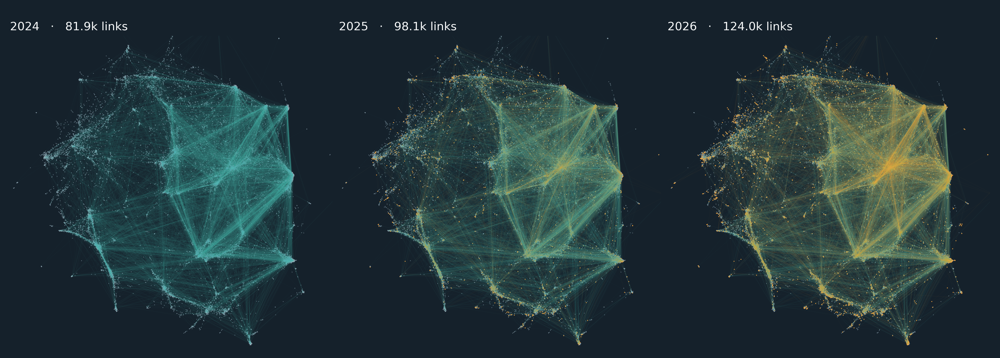
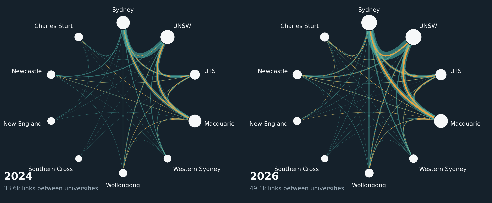

# NSW universities and the ORCID co-author network, 2024–2026

A follow-up to the 2026 release analysis. It looks at the ten New South Wales universities that write to their researchers' ORCID records, and follows the same researchers through the 2024, 2025 and 2026 public data files.

## Findings

| | 2024 | 2025 | 2026 |
|---|---|---|---|
| Co-author links between NSW researchers | 81.9k | 98.1k | 124.0k |
| Researchers with at least one link | 15.5k | 17.4k | 19.9k |
| Links between two different NSW universities | 34.1k | 40.1k | 49.9k |
| Links visible only through a university integration | 20.1k | 24.6k | 34.3k |

1. **Integrations.** Ten NSW universities write to ORCID. New England and Wollongong started in 2016, and Western Sydney in 2026 (`data/nsw_clients_by_snapshot.csv`).
2. **Reach.** Charles Sturt and Macquarie write works to about four in five of their research staff on ORCID. UNSW and Sydney, the two largest, reach about one in seven (`data/nsw_reach.csv`).
3. **The network.** Of the 42.3k links that are new since 2024, 16.6k (39%) are visible only because a university's own system sent the work.
4. **Sydney's first year.** Of the 26.1k links that appeared in the last year, 4.4k (1 in 6) exist only because of the University of Sydney's Profile Manager, and half of those connect to other NSW universities (`data/nsw_new_links_last_year.csv`).
5. **Affiliations.** 85–95% of the works added in the last year came from integrations at every university. The share of staff whose employment entry was written by the university ranges from 71% (Charles Sturt) to almost none (Sydney, Western Sydney). UNSW is the only university writing affiliations through the ORCID Member Portal (`data/nsw_emp_route.csv`).

## Definitions

- **Research staff.** An ORCID record with a current (no end date) employment entry at the university, at least one DOI work, and no student role in the entry. Universities are matched by employer name and country `AU`, so misspelt employers are missed.
- **Cohort.** Research staff at any NSW university, plus everyone an NSW university integration has written DOI works to: 23,557 iDs, fixed from the 2026 file. The same iDs are used in the 2024 and 2025 files.
- **Link.** Two iDs whose records share a DOI (self relationship). DOIs held by more than 100 iDs in a snapshot are excluded.
- **Only through a university integration.** On every DOI the pair shares, one side holds that DOI only from an NSW university's own ORCID client.
- **New link.** A pair that shared no DOI in the earlier snapshot. Credit for a new link goes to the university whose integration is the only source of a shared DOI on one side. Two universities can share the credit for one link.
- **University integrations.** The ORCID client IDs are listed in `sql/nsw_people.sql`. UNSW's research output system writes under a source identifier of the form `0000-…`, not an `APP-` client ID. A client named "University of Notre Dame – Digital Measures" belongs to the US university and is left out.

## Layout

| Path | What it holds |
|---|---|
| `sql/orcid_doi_{2024,2025,2026}.sql` | One row per iD, DOI and source for each snapshot |
| `sql/nsw_clients*.sql`, `sql/nsw_emp_writers.sql` | Finding the NSW integrations and tracking them across snapshots |
| `sql/nsw_reach.sql`, `sql/nsw_emp_route.sql` | Research staff, reach, and who wrote the employment entries |
| `sql/nsw_people.sql`, `sql/nsw_edges.sql` | The cohort and its co-author links for the three snapshots |
| `sql/nsw_new_links_*.sql` | Which integration made each new link visible |
| `scripts/draw_nsw_network.py`, `scripts/draw_uni_ring.py` | The network pictures (igraph and matplotlib) |
| `data/` | Query outputs and network statistics (aggregates only) |
| `images/` | The pictures |
| `post.md` | The LinkedIn post |

The cohort and link tables pair individual ORCID iDs, so they are not published here. To rebuild them, save the `orcid_doi_*`, `nsw_people` and `nsw_edges` queries as tables in your own dataset (replace `your-project.your_dataset`). Then export the links with the university of each side, and run the drawing scripts on the export.

## Caveats

- Public data only, so every count is a lower bound.
- The cohort is defined from 2026 records, so 2024 and 2025 describe the same people earlier, not who was on staff then.
- Each researcher is counted under one university: the one whose integration writes to them, otherwise their employer. 550 researchers have current employment at more than one NSW university.
- "Writing since" years come from the oldest entry from an integration that is still on a public record.
